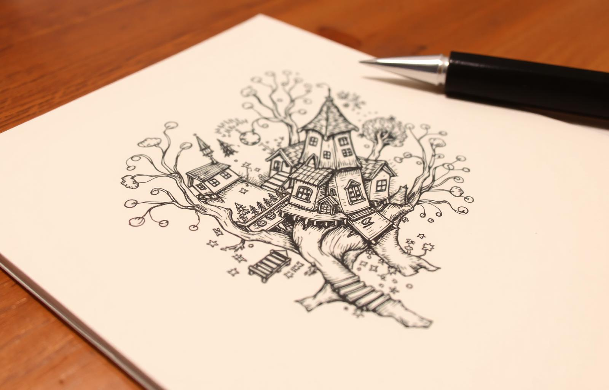

# bound.less

An infinite-zoom drawing canvas. Sketch a city, zoom into a window, draw the room inside — then keep going.

**Live demo: <https://bound-less-kk.web.app>** · [Read the case study](https://kobinkempe.pages.dev/case-studies/boundless/)

> **Built with AI: [Claude Code](https://claude.com/claude-code), [Codex](https://openai.com/codex/), [Cursor](https://cursor.com) and [Lovable](https://lovable.dev).**
> This project is my test of how far AI can take complex software. I direct and review the work, and AI agents write all of the code: about 165,000 lines so far, including the v2 zoom engine, its test harness and the current UI.



## What it does

- **Infinite zoom** — the canvas re-anchors itself every ×4,096 of magnification, so zoom depth is limited by your patience, not by floating-point precision or SVG limits. Draw detail at any depth and find it again on the way back out.
- **A full drawing kit** — pen, pencil, highlighter, and straight-line tools; select / move; undo-redo across everything.
- **Real-world scale** — drag across anything you've drawn and declare "this is 1 inch" (or 40 meters, or 3 miles). A scale bar then tracks every zoom, walking a ladder of sensible units from millimeters to miles as you dive and climb.
- **Scenes** — the coherent drawings hidden inside a canvas are found automatically and kept in a scene index saved with the file, updated in a background worker as you draw, erase and move, never re-clustered (spec: [`docs/reference/scenes-v3-design-bible.md`](docs/reference/scenes-v3-design-bible.md)): widths decide nesting, so fine detail inside a drawing — or carved into it by a fine eraser — is its own scene rather than lost in the zoom. Scenes get rendered thumbnails and one-tap jumps at their natural zoom, and can be renamed.
- **Local-first saving** — work saves to your browser and stays there by default. Sign in with Google to sync canvases (thumbnails included) to your account and pick them up on any device. Drawings also export and import as `.boundless.json` files, plus SVG export.

## How the engine works

The interesting problem: browsers (and doubles) give out long before "infinite." The engine in [`src/engine/`](src/engine) treats depth as a chain of **levels**, each ×4,096 the magnification of the last — a power of two, so crossing one spends no precision at all, and keeps all geometry in the coordinate frame of the level where it was drawn:

| Piece | Job |
| --- | --- |
| `Camera` | Level-local view transform; crosses between levels when zoom passes enter/exit thresholds (with hysteresis so the boundary doesn't flicker) |
| `Document` | Strokes live in their home level; ids double as z-order; undo/redo as operation log; spatial index for hit-testing |
| `LevelMap` / `TileStore` | Cross-level views are *derived*: bidirectional tiles with empty / solid / edge classification, so a stroke magnified ×4,096⁵ collapses to bounded tile fills instead of exploding |
| `raster/` | The default renderer: the engine's own float64 coverage rasteriser, in Web Workers, fills 512-pixel plates that are cached and composed onto one canvas, with older plates standing in while new ones arrive |
| `Renderer` | The SVG renderer (behind `?svg`) and the raster renderer's base class: persistent per-object Two.js groups, updated by diffing, with per-level scene retention so level crossings reattach instead of rebuilding |
| `geometry/` | Ink is **circular arcs**, not cubics: the offset of an arc is a concentric arc, so both edges of a stroke are exact with no fit tolerance and erasing is an exact arc boolean at any depth |
| `persist.js`, `format2.js`, `oplog.js` | The versioned file format (`kobin-1`) with validation, and the store behind autosave and sync (`kobin-2`): per-frame snapshots as flat float arrays plus an op log, so a save is an append and undo history survives a reload |
| `scaleBar/` | The real-unit scale system: unit catalogs, preference "ladders," and sticky per-session display choices |

The suite is about 2,250 Jest tests across 131 suites (107 of them, 1,649 tests, in the quick run), including a fidelity harness that replays recorded drawings and compares rendered ink against ground truth pixel-for-pixel across level crossings.

**[`DESIGN.md`](DESIGN.md) is the whole design in one document** — why the coordinates work the way they do, and what each decision cost to learn. The design history it was distilled from — bugs, dead ends, measured perf wins (one pathological tile bake went from 585 s to 550 ms) — is in [`docs/issue-log.md`](docs/issue-log.md) and [`docs/reference/`](docs/reference).

## Run it locally

Requires **Node 14** — the toolchain is an older Create React App setup.

```bash
npm install
npm start        # http://localhost:3000
npm test         # jest suite
npm run build    # production build to build/
```

Deploys are plain Firebase Hosting: `firebase deploy --only hosting` (config in `firebase.json`).

**Working on this?** Read [`DESIGN.md`](DESIGN.md) first, then [`docs/ai/00-START-HERE.txt`](docs/ai/00-START-HERE.txt) — the current status, a code map, and the live issue list, written for someone with no context.

**Dev tools:** append `?dev` to a canvas URL (e.g. `/#/canvas/new?dev`) to reveal the engine's developer panel — live level/zoom/object readouts, the debug overlays, and the diagnostic Report button.

## Roadmap

The plan of record is [`docs/ROADMAP.md`](docs/ROADMAP.md): fix autosave, deploy, performance and bugs, then UX, with the structural work running underneath. Product features queued there:

- AI-suggested scene names (Gemini's free tier — once the build toolchain modernizes enough for Firebase AI Logic)
- Rotation and measurement tools

## History

bound.less began in 2021 as a university team project by Michael Sawchuk, Kobin Kempe, Anuja Mehta, and Nolan Raghu, which proved out the idea but stopped at SVG's practical zoom limits. This repository is Kobin Kempe's continuation: the v2 level-crossing engine, the drawing and selection toolset, the real-unit scale system, account sync, and the current interface.
